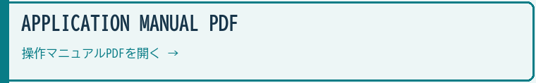
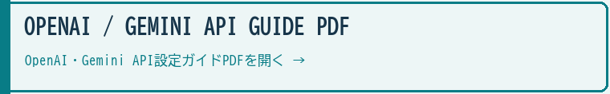

# AI Comic Translation Tool / AI漫画翻訳ツール

**Gemini model route / Geminiモデル候補**: `gemini-3.8-flash` → `gemini-3.6-flash` → `gemini-3.5-flash-lite` → `gemini-3.1-flash-lite`. Explicit stable IDs avoid the December 1, 2026 redirects; image-generation models keep their dedicated routes. / 2026年12月1日の旧モデル自動転送に依存しないよう、現行GAモデルを明示します。画像生成は専用のモデル経路を使います。

> **MIT License; your outputs remain yours.** You may use, modify, redistribute and sell the app, including in paid products and services, without individual permission from FURU. Retain the copyright and MIT license notices in copies or substantial portions of the software. External API fees and third-party terms are separate. / **アプリはMITライセンス。成果物の権利は従来どおり利用者に帰属します。** アプリの利用・改変・再配布・販売、有料商品やサービスへの組み込みに、FURUへの個別許可は不要です。ソフトウェアの複製または重要な部分には著作権表示とMITの許諾表示を残してください。外部API料金と第三者の条件は別です。

Demo URL / デモサイト: [https://furuyan1234.github.io/comic-translation/](https://furuyan1234.github.io/comic-translation/)

### PDF manuals / PDFマニュアル

Japanese A4 guides cover application operation and OpenAI / Gemini API setup. / 日本語A4版でアプリの操作とOpenAI・Gemini APIの取得・設定を説明します。

> **"Translate manga into 10 languages with one click."** / **「漫画をワンクリックで10言語に翻訳する実験的Webアプリケーション」**
>
>
>
> Powered by Dual API Architecture (Gemini & OpenAI) — Automatic text extraction, translation, horizontal flip, and image regeneration. / Gemini & OpenAIのDual APIアーキテクチャを活用し、テキスト抽出・多言語翻訳・左右反転・画像再生成を完全自動化。

---

This project is an experimental tool designed to automate the labor-intensive process of manga translation, typesetting, and redrawing by leveraging the multimodal capabilities of the Gemini API and OpenAI API. / 本プロジェクトは、Gemini APIおよびOpenAI APIのマルチモーダル機能を活用し、漫画の翻訳、写植、リドローという労働集約的な作業を自動化することを目的とした実験的ツールです。

**v2.0.2** — Added Japanese application and API PDF guides with in-app links. / 日本語の操作・API設定PDFとアプリ内リンクを追加しました。

Select from all 12 models, with Astra highest and 6.1 Sol default. Fallback starts at the selected model and only moves downward; selection, attempts and adoption are shown. Unknown IDs are rejected before API calls. / 全12モデルを選択できます。GPT-6 Astraを最上位、GPT-6.1 Solを既定とし、選択モデルから下位のみ試行します。選択・試行・採用を表示し、未知IDはAPI呼び出し前に拒否します。価格は入力/出力USD per 1M tokensで表示し、推論トークンや処理回数で実費が変わります。

OpenAI fallback: `gpt-6-astra` → `gpt-6.1-sol` → `gpt-6.1-terra` → `gpt-6-sol` → `gpt-5.6-sol` → `gpt-5.6-terra` → `gpt-6-luna` → `gpt-5.6-luna` → `gpt-4.1` → `gpt-4.1-mini` → `gpt-4.1-nano` → `gpt-4o`. GPT-6.1 Sol and Terra use a 32,768-token completion budget. Incomplete, refused and empty responses are rejected; output-budget exhaustion, authentication, billing/quota and policy failures stop retries. / 途中終了・拒否・空応答を成功扱いせず、出力上限到達・認証・残高不足・ポリシー拒否は連続試行を停止します。画像モデルと既存翻訳ルールは維持します。

## 🚀 Overview / 概要

This tool automates the process of translating manga pages into 10 languages (English, Japanese, Chinese, Korean, French, Spanish, etc.) using a two-stage AI pipeline. / 漫画のページをAIの2段階パイプラインで10言語（英語、日本語、中国語、韓国語、フランス語、スペイン語など）に翻訳するツールです。

### Translation Pipeline / 翻訳パイプライン

1. **Text Extraction & Translation / テキスト抽出・翻訳**: The AI engine analyzes the manga image and extracts all text elements (titles, dialogue, SFX, narration) with high-precision translations. / AIエンジンが漫画画像を解析し、全テキスト要素（タイトル、セリフ、擬音、ナレーション）を高精度で抽出・翻訳します。

2. **Image Regeneration / 画像再生成**: The original image is automatically flipped if required by the target reading order, and the image model regenerates the page with translated text naturally integrated into the artwork. / 翻訳元・翻訳先の読み順に合わせて画像を必要に応じて自動で左右反転し、画像モデルが翻訳テキストを元のアートワークに自然に統合したページを再生成します。

## Current Release Line / 現行仕様

Version **v2.0.2** uses a two-stage translation workflow. OpenAI image editing uses GPT Image 2.6 Sunburst; failures retain their cause without switching to GPT Image 2.0. / **v2.0.2** は2段階で翻訳します。OpenAI画像編集はGPT Image 2.6 Sunburstを使用し、失敗時は原因を表示して停止します。GPT Image 2.0への自動切替は行いません。

* **Gemini image generation / Gemini画像生成**: The active Gemini image path is `gemini-nano-banana-2.1` only. Legacy preview and old 2.5 image options have been removed from the user-facing image generation path. / Gemini画像生成の現行経路は `gemini-nano-banana-2.1` のみです。旧プレビュー系や古い2.5画像オプションは、ユーザー向けの画像生成経路から外しています。
* **OpenAI image generation / OpenAI画像生成**: `gpt-image-2.6-sunburst`, xhigh quality, PNG output through the edit API, with a 600-second limit and no automatic image-model fallback. / `gpt-image-2.6-sunburst` のxhigh品質・PNG出力を編集APIで使用します。上限は600秒で、画像モデルは自動切替しません。
* **Security boundary / セキュリティ境界**: API keys remain memory-only. The app does not write provider keys to localStorage, source files, or generated artifacts. / APIキーはメモリ限定です。localStorage、ソースファイル、生成物にはプロバイダーキーを書き込みません。
* **Iteration model / 反復修正モデル**: When the user regenerates, the translated image can be used as the next base image, so corrections are layered through explicit user instructions rather than hidden automatic rewriting. / 再生成時は翻訳済み画像を次のベースにできるため、隠れた自動改変ではなく、ユーザーが明示した修正指示を重ねる形で反復改善します。

---

## 🏗️ Unique Architecture Highlights / 固有アーキテクチャの要点

This system goes beyond simple machine translation by implementing strict controls to preserve the original artistic intent while adapting to different languages. / 本システムは単純な機械翻訳にとどまらず、言語の適応を行いながらもオリジナルの芸術的意図を維持するための厳密な制御を実装しています。

* **Dual API Architecture (Zenith Protocol) / デュアルAPIアーキテクチャ**: Seamlessly switch between two powerful AI engines based on the input API key. / 入力されたAPIキーから自動でエンジンを判別し、ルーティング層を介して処理を切り替えます。
  * **🔵 Gemini Mode (Default)**: Extremely fast processing, zero intervention required. Free to use within Google AI Studio limits. / 圧倒的な処理速度。Google AI Studioの無料枠内で利用可能。
  * **🟢 ChatGPT Mode (OpenAI)**: World-class translation quality, perfectly capturing cultural nuances and character voices (role-language). Note: Uses a pay-as-you-go billing model. / 世界最高峰の翻訳精度。意訳やキャラクターの役割語を完璧に捉えます。※OpenAIの従量課金モデルが適用されます。

* **Context-Aware Multimodal Translation / コンテキストを維持したマルチモーダル翻訳**: Unlike standard OCR+GPT workflows that translate text line-by-line, this tool leverages the AI engine's massive context window and native vision capabilities. It reads the entire manga page as a single cohesive unit, understanding the flow of conversation, character tone, and visual context simultaneously. This prevents awkward literal translations and maintains character voice across the scene.
  Unlike line-by-line OCR and translation, the engine reads the entire page with its context window and native vision. It considers dialogue flow, character voice and visual context together to reduce awkward literal translation and retain a consistent tone. / 単純に文字を抽出して一行ずつ翻訳する従来のOCR＋GPT方式とは異なり、AIエンジンの巨大なコンテキストウィンドウとネイティブな視覚能力（Vision）を活用します。漫画のページ全体をひとつの繋がりとして読み取り、前後の会話の文脈、キャラクターの口調、視覚的な状況（誰がどんな表情で話しているか）を同時に理解することで、直訳による不自然さを防ぎ、シーン全体で一貫したキャラクターのトーンを維持します。

* **Casing Protection Protocol / ケーシング保護プロトコル**: Automatically protects technical strings like URLs, ISBNs, and email addresses in margin text from being forced to ALL CAPS, while maintaining comic-style ALL CAPS for dialogue, titles, and SFX. / 欄外のURL・ISBN・メールアドレス等の技術的文字列が全大文字化されないよう保護しつつ、吹き出し内セリフ・タイトル・擬音はコミックスタイルの大文字を維持します。

* **Automated Image Flip Logic / 自動左右反転ロジック**: Accurately defaults the "Flip Image" switch ON or OFF automatically based on the native reading direction (RTL/LTR) of both input and target translation languages (e.g. Japanese ⇄ English). / 翻訳元・先の言語ごとの本来の読み方向（右から左／左から右）に基づく、自然な左右反転判定アルゴリズムを実装。

* **Iterative Refinement Engine / 反復修正エンジン**: When regenerating images, the system uses the already translated image as a base, allowing users to apply specific correction rules via the instruction builder for true iterative refinement. / 再生成ルール使用時、翻訳済み画像をベースにAPIへ送信し、指示ビルダーを通じて特定の修正ルールを適用することで、真の反復的な修正・改善を可能にします。

* **Anti-Degradation Prompting / 画質劣化防止プロンプト**: Incorporates model-optimized quality preservation instructions to prevent line-art, screen-tone, and color palette degradation during multiple generation passes. / 複数回の生成パスにおける線画・スクリーントーン・カラーパレットの劣化を防ぐため、各モデルに最適化された画質保護プロンプトを組み込んでいます。

---

## ✨ Features / 機能

- **Drag & Drop Input / ドラッグ&ドロップ入力**: Simply drop a manga page image to begin.
- **Editable Translations / 翻訳編集**: Review and modify translations before image generation.
- **Bilingual UI / 完全日英対応UI**: Full English/Japanese support for all buttons, toggles, prompts, and status messages.
- **Download / ダウンロード**: Save the translated image with one click.
- **Session-Only API Key / セッション限定APIキー**: API key is stored in memory only — never saved to disk or localStorage.
- **Universal Prompt Generator / 汎用プロンプト生成**: Generate a copy-paste translation prompt for ChatGPT and other web AI services — no API key required. Supports language selection, flip toggle, and per-service compatibility notes. / ChatGPTなどのWebサービスで使える翻訳プロンプトをワンクリック生成。APIキー不要。言語選択・反転トグル・サービス別対応状況の注記付き。

---

## 💻 Tech Stack / 技術スタック

* **Frontend**: React 19 / Vite 8 / Vanilla CSS / フロントエンド：React 19／Vite 8／Vanilla CSS。
* **AI Routing**: Zenith Protocol Architecture (Dual Engine Abstraction) / AI経路：両エンジンを抽象化するZenith Protocol。
* **LLM/VFM (Gemini)**: Text/OCR `gemini-3.8-flash` → `gemini-3.6-flash` → `gemini-3.5-flash-lite` → `gemini-3.1-flash-lite`; Image `gemini-nano-banana-2.1` / Gemini：文章／OCRは記載した順のフォールバック、画像はgemini-nano-banana-2.1。
* **LLM/VFM (OpenAI)**: Text `gpt-6-astra` → `gpt-6.1-sol` → `gpt-6-sol` → `gpt-5.6-sol` → `gpt-5.6-terra` → `gpt-6-luna` → `gpt-5.6-luna` → `gpt-4.1` → `gpt-4.1-mini` → `gpt-4.1-nano` → `gpt-4o`; Image `gpt-image-2.6-sunburst` (Edit API, PNG/xhigh, 600s timeout, no automatic model fallback) / OpenAI：文章は記載した順のフォールバック。画像はGPT Image 2.6 SunburstのEdit API・PNG／xhighを使い、600秒上限で自動モデル切替は行いません。
* **Image Processing**: Canvas API (Horizontal Flip / 左右反転処理)
* **Security**: Memory-only API key management (no localStorage, no hardcoding) / 安全対策：APIキーはメモリだけに保持し、localStorageへの保存や埋め込みを行いません。

---

## 📝 Setup & Launch / セットアップと起動

### 🌍 Cloud / Browser (Deploy) / ブラウザー公開版

1. **Get API Key**: Obtain a Gemini API key at [Google AI Studio](https://aistudio.google.com/) or an OpenAI API key at [OpenAI Platform](https://platform.openai.com/). / Google AI StudioでGemini APIキー、またはOpenAI PlatformでOpenAI APIキーを取得します。
   Obtain a Gemini API key from Google AI Studio or an OpenAI API key from OpenAI Platform. / [Google AI Studio](https://aistudio.google.com/) で Gemini API キー、または [OpenAI Platform](https://platform.openai.com/) で OpenAI API キーを取得してください。
2. **Access**: Open the deployed web app ([Comic Translation Tool](https://furuyan1234.github.io/comic-translation/)) and enter your API key. / [Webアプリ (デモサイト)](https://furuyan1234.github.io/comic-translation/) にアクセスし、APIキーを入力してスタートします。

### 💻 Local Launch (Windows) / ローカルでの起動 (Windows)

1. **Download**: Download the Source Code (ZIP) from [Releases](../../releases) or click "Code" -> "Download ZIP". / [Releases](../../releases) または "Code" ボタンからZIPファイルをダウンロードします。
2. **Unzip**: Extract the ZIP file to any folder. / ダウンロードしたZIPファイルを解凍してください。
3. **Run**: Double-click `start_comic_transration.bat`. / フォルダ内の `start_comic_transration.bat` をダブルクリックします。
   *(Node.js required / 事前にNode.jsのインストールが必要です)*
4. **Start**: The system will automatically install dependencies and launch the browser. / 必要なライブラリが自動インストールされ、ブラウザが立ち上がります。

---

## ⚖️ Compliance & Legal Stance / 法的遵守について

### Japanese Copyright Law (Article 30-4) / 日本の著作権法（第30条の4）

This project is developed in full compliance with **Article 30-4 of the Japanese Copyright Act**, which allows for the exploitation of copyrighted works for information analysis and technological development of AI. / 本プロジェクトは、日本の著作権法第30条の4（情報解析目的の利用）に基づき、技術検証および情報解析を目的として開発されており、法的に適正な範囲内で公開されています。

### Official API Usage / 公式APIの利用

All generations are performed through the **official Google Gemini API and OpenAI API**. This system adheres strictly to the Terms of Service and Forbidden Use Policies of both Google and OpenAI. / 本システムはGoogle公式のGemini APIおよびOpenAI公式のAPIを介して動作しており、各社が定める「生成AI禁止事項」および利用規約を厳格に遵守しています。

### Translation Purpose / 翻訳の目的

This tool is designed for **translation assistance** of original works by their rightful owners. It is not intended for unauthorized reproduction or distribution of copyrighted material. / 本ツールは、正当な権利者による**翻訳支援**を目的としています。著作権のある素材の無許可複製や配布を意図したものではありません。

---

## Terms & Output Rights / 利用条件・作品の権利

### MIT license for the app / アプリ本体はMITライセンス

From November 12, 2026, the current source of this app is available under the [MIT License](LICENSE). This applies to the program, bundled prompts and accompanying documentation that FURU has authority to license. / 2026年11月12日より、本アプリの現行ソースを[MITライセンス](LICENSE)で公開します。FURUが許諾権限を持つプログラム、同梱プロンプト、付属文書が対象です。

You may use, copy, modify, merge, publish, distribute, sublicense and sell the software, including paid redistribution, paid services and bundling with paid teaching materials, without individual permission, prior contact or a license fee to FURU. / 利用・複製・改変・結合・公開・配布・再許諾・販売ができます。有料再配布、有料サービスへの組み込み、有料教材への同梱にも、FURUへの個別許可・事前連絡・ライセンス料は不要です。

Include the copyright notice and the MIT permission notice in all copies or substantial portions of the software. The software is provided as is, without warranty, as stated in the license. / ソフトウェアのすべての複製または重要な部分に、著作権表示とMITの許諾表示を含めてください。ソフトウェアは、ライセンスに記載のとおり無保証で現状のまま提供します。

### Your outputs remain yours / 成果物の権利は従来どおり利用者に

Rights in the text, images, comics, audio, video and other works you create remain with you as before. FURU does not acquire rights in your outputs merely because you use this app, and the app's MIT license does not automatically apply to your outputs. / 作成した文章・画像・漫画・音声・動画などの成果物の権利は、従来どおり利用者に帰属します。アプリを使ったことを理由にFURUが成果物の権利を取得することはなく、アプリのMITライセンスが成果物へ自動的に適用されることもありません。

You may publish, sell, monetize and deliver your works without permission, fees or credit to FURU. If an output includes copies or modifications of the app's code or other licensed software, retain the applicable notices for those portions. / 自分の作品は、FURUへの許可・利用料・クレジット表記なしで公開・販売・収益化・納品できます。成果物にアプリのコードなどソフトウェアの複製・改変を含める場合、その部分には該当ライセンスの表示を残してください。

### Third-party materials and services / 第三者の素材・サービス

Third-party code, models, assets, voices, separately bundled projects and external services retain their own licenses and terms. API charges, attribution requirements and rights in source materials must be checked separately. This license does not grant rights that FURU does not hold. / 第三者のコード・モデル・素材・音声、同梱の別プロジェクト、外部サービスには、それぞれのライセンス・利用条件が適用されます。API料金、クレジット義務、入力素材の権利は別途確認してください。FURUが持たない権利をこのライセンスで許諾するものではありません。

### Earlier distributions / 過去の配布物

This change applies to the current source distributed with this MIT license and subsequent versions. Existing release ZIPs are not rewritten; check their attached license. Valid earlier permissions are not revoked. The [previous notices](docs/licenses/previous-notices.md) are retained as history. / 今回の変更は、このMITライセンスを添付した現行ソースと今後の版に適用します。既存のリリースZIPは書き換えていないため、添付のライセンスを確認してください。過去に有効に付与された許諾は取り消しません。[以前の表示](docs/licenses/previous-notices.md)は履歴として残しています。

## Browser security / ブラウザーの安全対策

This update further strengthens security while preserving the existing creation workflow. / 今回の更新では、既存の制作フローを保ちながらセキュリティをさらに強化しました。

The app limits script execution and API connections with Content Security Policy, disables embedded frames and form submissions, and sends no referrer. Open the app directly in its own tab. API keys remain sensitive while in memory; these protections do not guarantee the absence of every vulnerability. Every deployment checks dependencies, source safeguards and the built policy. / CSPでスクリプト実行・API接続先を制限し、埋め込み表示とフォーム送信を禁止、参照元情報を送信しません。アプリは直接タブで開いてください。メモリー内のAPIキーも機密情報であり、すべての脆弱性がないことを保証するものではありません。毎回のデプロイで依存ライブラリ・ソースの防御・ビルド後の設定を検査します。

## AI Manga Creative Suite / AIまんが制作エコシステム

This app is one component in a broader AI-assisted manga and story production workflow. / このアプリは、AIを活用した漫画・物語制作ワークフローの一部です。

### Ecosystem Components / 構成システム

#### 1. Super FURU AI 4-koma System / Super FURU AI 4コマシステム
A system specialized in creating 4-panel manga with AI. / AIを活用した4コマ漫画制作に特化したシステムです。
- [Explanation / 解説](https://note.com/happy_duck780/n/ndf063558c1f5)
- [Demo / デモ](https://furuyan1234.github.io/nano-banana-pro/)
- [Code / コード](https://github.com/FURUYAN1234/nano-banana-pro)

#### 2. AI Story Maker
A tool for generating creative stories and plots using AI. / AIを用いてクリエイティブなストーリーやプロットを生成するツールです。
- [Explanation / 解説](https://note.com/happy_duck780/n/nd3d972922868)
- [Demo / デモ](https://furuyan1234.github.io/story-maker/)
- [Code / コード](https://github.com/FURUYAN1234/story-maker)

#### 3. AI Character Sheet Maker / AIキャラクターシートメーカー
An assistant for designing detailed character sheets and settings. / 詳細なキャラクターシートや設定をデザインするための支援ツールです。
- [Explanation / 解説](https://note.com/happy_duck780/n/neccbebd7d957)
- [Demo / デモ](https://furuyan1234.github.io/character-sheet-maker/)
- [Code / コード](https://github.com/FURUYAN1234/character-sheet-maker)

#### 4. AI Comic Translation Tool / AI漫画翻訳ツール
A tool for translating manga into 10 languages using AI. / AIを使って漫画を10言語に翻訳するツールです。
- [Explanation / 解説](https://note.com/happy_duck780/n/ne462dfc55ec8)
- [Demo / デモ](https://furuyan1234.github.io/comic-translation/)
- [Code / コード](https://github.com/FURUYAN1234/comic-translation)

#### 5. 360° AI Panorama Generator / 360度AIパノラマ生成ツール
A tool that generates seamless 360-degree spatial backgrounds to provide background assets for manga and video. / シームレスな360度空間の背景を生成し、漫画や動画の背景素材として提供するツールです。
- [Explanation / 解説](https://note.com/happy_duck780/n/nb53b121fef88)
- [Demo / デモ](https://furuyan1234.github.io/panoforge/)
- [Code / コード](https://github.com/FURUYAN1234/panoforge)

#### 6. AI Voice Comic Maker / AI音声コミックメーカー
A tool to automatically convert static 4-koma manga into fully voiced animated videos. / 静止画の4コマ漫画をフルボイスの動画に自動変換するツールです。
- [Explanation / 解説](https://note.com/happy_duck780/n/ndc6533c1512f)
- [Code / コード](https://github.com/FURUYAN1234/ai-voice-comic-maker)

| **Tool / ツール** | **Role / 役割** | **Repository / リポジトリ** |
| --- | --- | --- |
| Super FURU AI 4-koma System / Super FURU AI 4コマシステム | AI 4-panel manga generation / AI 4コマ漫画生成 | [nano-banana-pro](https://github.com/FURUYAN1234/nano-banana-pro) |
| Story Maker | Story and plot generation / 物語・プロット生成 | [story-maker](https://github.com/FURUYAN1234/story-maker) |
| AI Character Sheet Maker / AIキャラクターシートメーカー | Character reference generation / キャラクター資料生成 | [character-sheet-maker](https://github.com/FURUYAN1234/character-sheet-maker) |
| AI Comic Translation Tool / AI漫画翻訳ツール | Manga translation and regeneration / 漫画翻訳・再生成 | [comic-translation](https://github.com/FURUYAN1234/comic-translation) |
| 360° AI Panorama Generator / 360度AIパノラマ生成ツール | 360-degree background generation / 360度背景生成 | [panoforge](https://github.com/FURUYAN1234/panoforge) |
| AI Voice Comic Maker / AI音声コミックメーカー | Voice comic video generation / フルボイス動画化 | [ai-voice-comic-maker](https://github.com/FURUYAN1234/ai-voice-comic-maker) |
| Monogatari Buzz Maker / 物語バズメーカー | Trend research and creative planning / トレンド調査・創作企画 | [viral-radar](https://github.com/FURUYAN1234/viral-radar) |
| Narration Video Maker / ナレーション動画メーカー | Video generation with narration, subtitles, and BGM / ナレーション・字幕・BGM付き動画生成 | [gemini-narration-studio](https://github.com/FURUYAN1234/gemini-narration-studio) |

## 🔄 Changelog / 更新履歴

### v2.0.1 (2026-11-11)

- Removed the GPT Image 2.0 fallback route. GPT Image 2.6 remains the image model; provider failures do not silently switch to the retired model. / GPT Image 2.0への代替経路を除去しました。画像モデルのGPT Image 2.6を維持し、失敗時に旧モデルへ自動切替しません。

### v2.0.0 (2026-11-05)
- OpenAI translation image editing starts with GPT Image 2.6 Sunburst / xhigh. / OpenAIでの翻訳画像編集ではGPT Image 2.6 Sunburst / xhighを優先します。

### v1.9.8 (2026-10-30)

- Distributed builds now include complete third-party notices; postbuild rejects missing, changed or stale notices. / 第三者通知全文を配布物に同梱し、ビルド後に欠落・改変・版違いを検査します。
- Preserved the existing FURU license and translation workflow. / FURU独自ライセンスと翻訳処理は維持しています。

### v1.9.7 (2026-10-27)

- Added GPT-6.1 Terra after Sol in the selectable OpenAI text/Vision chain with the official $1 input / $5 output per million token standard rates. Image editing routes are unchanged. / OpenAIのテキスト・画像解析の選択肢にGPT-6.1 TerraをSolの次に追加し、標準単価の入力$1・出力$5／100万トークンを表示します。画像編集の経路は従来どおりです。

### v1.9.6 (2026-10-07)

- Gemini translation extraction now omits custom sampling settings and uses model defaults. / Geminiの翻訳用の文字抽出で、独自のサンプリング設定を送らず、モデル標準設定を使用します。
- Image inputs, JSON output settings, and output limits are preserved. / 画像入力・JSON出力設定・出力上限を維持しています。

### v1.9.5 (2026-10-07)

- Security: CSP and frame protection, dependency updates, and mandatory release checks. / CSP・埋め込み防御・依存更新・公開前検査を追加。

### v1.9.4 (2026-10-07)

- Translation and refinement images now use Nano Banana 2.1 through the Interactions API. / 翻訳画像と追加修正をNano Banana 2.1のInteractions APIへ更新しました。

### v1.9.3 (2026-10-04)

Clarify free personal, business and commissioned use and monetization of users' own outputs. Paid redistribution, paid services based on the app and bundling with paid information products require prior written permission. Valid prior grants and third-party terms remain available. / 個人・業務・受託制作での無料利用と、自分の投稿・作品の収益化を明確化。アプリ本体の有料再配布・有料サービス化・有料商材への同梱は事前許可制です。過去の有効な許諾と第三者の条件は保持します。

### v1.9.2 (2026-10-01)

- **[OpenAI Image / OpenAI画像]** GPT Image 2.5 Sunburst/xhigh is now the first choice for OpenAI image editing. Retry-eligible provider failures fall back to GPT Image 2.0/high within the same 600-second request window. / OpenAI画像編集の優先モデルをGPT Image 2.5 Sunburst/xhighに変更しました。リトライ対象のプロバイダー失敗時は、同じ600秒枠内でGPT Image 2.0/highへ切り替えます。

### v1.9.0
- **[API / Fallback Chain]** Updated the Gemini image generation path to the current Nano Banana 2-compatible model `gemini-3.1-flash-image` and removed legacy preview/2.5 image model options from the UI fallback list. / Gemini画像生成を現在のNano Banana 2互換モデル `gemini-3.1-flash-image` に更新し、旧preview/2.5画像モデルをUIのフォールバック選択肢から撤去しました。
- **[OpenAI / Image Edit]** Aligned OpenAI image editing with the current `gpt-image-2` behavior: PNG output, high quality, returned MIME preservation, and a 600-second timeout for slower edits. / OpenAI画像編集を現在の `gpt-image-2` 運用に合わせ、PNG出力・高品質・MIME保持・600秒タイムアウトへ更新しました。
- **[Deploy / Version]** Synchronized app version files and deployment notes for v1.9.0. / v1.9.0としてバージョン表示・リリース情報を同期しました。

### v1.8.9
- **[Fix / Translation]** Fixed a critical bug where selecting any non-English target language (Korean, Chinese, French, etc.) would still produce English translations. The root cause was that the few-shot JSON example in the AI extraction prompt had hardcoded English translations (`"translated": "Title"`, `"translated": "KABOOM"`), causing the AI to mimic the English example regardless of the language instruction. Added per-language sample translations to `languages.js` and dynamically inject them into prompts for both Gemini and OpenAI engines. / **全言語が英語出力になる致命的バグを修正しました。** 韓国語・中国語・フランス語など英語以外の言語を選択しても英語で翻訳されてしまう問題の原因は、AIへのプロンプト内のJSONサンプルが英語固定（`"translated": "Title"`等）だったことでした。AIがfew-shot exampleに引っ張られて指示文を無視していたため、各言語のサンプル翻訳を動的に埋め込むよう修正しました。
- **[Fix / UI]** Fixed the clear button tooltip showing "英訳を消去" (Clear English translation) regardless of the selected target language. Now dynamically shows the selected language name (e.g., "한국어訳を消去"). / 翻訳クリアボタンのツールチップが選択言語に関わらず「英訳を消去」と表示されていたバグを修正。選択中の言語名が動的に反映されるようになりました。
- **[Fix / UI]** Fixed the flip hint display to dynamically reflect the actual reading direction based on source/target language pair, instead of showing a static LTR/RTL label. / フリップヒントの表示をソース/ターゲット言語ペアの読み方向から動的に判定するよう修正しました。

### v1.8.8
- **[Fix / Console]** Fixed lint errors and removed unused imports/variables. Cleaned up production console logs by removing unnecessary engine switch logs. / lintエラーおよび未使用のimportや変数を修正しました。また、エンジン切替時の不要なconsole.logを削除し、本番環境のコンソールをクリーンアップしました。

### v1.8.7
- **[Fix / Prompt]** Enhanced the Gemini `## MIRRORED IMAGE ALERT` prompt to strictly enforce the complete erasure of all mirrored text (including background watermarks and copyrights) when processing horizontally flipped images. This resolves the issue where Gemini would faithfully preserve mirrored watermarks as part of the artwork. / Geminiの鏡文字対策プロンプト（`## MIRRORED IMAGE ALERT`）を強化し、反転画像の処理時に翻訳対象外の裏返った文字（ウォーターマークやコピーライトなど）も背景ごと完全に消去するよう厳格な命令を追加しました。これにより、Geminiが裏返ったウォーターマークをアートワークの一部として残してしまうバグを完全に修正しました。

### v1.8.6
- **[Model Sanitization / Deploy]** Completely removed remaining legacy/hallucinated model names from documentation to ensure absolute system stabilization, and executed production deploy. / ドキュメント内に残存していた架空のプレビューモデル名を完全に排除し、正式版デプロイを行いました。

### v1.8.0
- **[Stable Release / Deploy]** Full deploy and version stabilization following the successful unification of the Gemini and OpenAI image generation prompts. The rigid "ART PRESERVATION" constraints have proven to completely eliminate Gemini's layout hallucination and dialogue cross-wiring bugs. All internal proper nouns and temporary comments have been audited and removed prior to deployment. / GeminiとOpenAIの画像生成プロンプトの完全統合が成功し、レイアウト破綻バグが完全に解消されたことを受けての安定版デプロイ。ソースコード内の固有名詞や不要なコメントをクリーンアップし、本番環境へと反映しました。

### v1.7.9
- **[Fix / Prompt]** Completely unified the Gemini image generation prompt with the highly successful OpenAI prompt structure. Visual inspection revealed that the previous Gemini prompt (which prioritized "text erasure" over "art preservation") was causing the Gemini models to aggressively redraw the artwork, leading to completely hallucinated panel layouts and swapped character positions (cross-wiring dialogue bubbles). By strictly enforcing the `ART PRESERVATION (NON-NEGOTIABLE): The output image must be IDENTICAL to the input` constraints identical to the OpenAI prompt, Gemini is now forced to perform a precise text-replacement image editing task without altering the original artwork or spatial relationships. / Geminiの画像生成プロンプトの構造を、完璧な結果を出しているOpenAI側のプロンプト構造に完全に統合・統一しました。画像比較検証により、以前のGeminiプロンプト（アート保護よりもテキスト消去を優先した緩和設定）が原因で、Geminiモデルが「文字を入れるために絵を勝手に描き直す」という暴走状態に陥り、キャラの立ち位置やコマ割りを幻覚してセリフを混線させていたことが発覚しました。今回、OpenAIと同じ「元画像とピクセルレベルで完全一致させよ（アートの改変は一切許さない）」という厳格な制約を復活させたことで、Geminiでも絵を崩さずにテキストだけを正確に差し替える完璧な挙動が復元されました。

### v1.7.8
- **[Model / Layout Accuracy]** Switched the default image generation model from `gemini-2.0-pro-exp` to `gemini-2.0-flash`. While the Pro model possesses high overall intelligence, visual verification revealed that its spatial reasoning and layout constraints were too loose, causing it to hallucinate the placement of text and cross-wire dialogues between different panels. The next-generation `gemini-2.0-flash` model, however, demonstrated perfect adherence to spatial constraints, flawless mirrored-text erasure, and impeccable placement of translated text into the correct speech bubbles. Therefore, `2.0 Flash` has been designated as the primary default model to ensure optimal layout accuracy. / 画像生成のデフォルトモデルを `gemini-2.0-pro-exp` から `gemini-2.0-flash`（安定動作モデル）へ変更しました。実機検証の結果、Proモデルは全体の知能は高いものの自由度が高すぎるのか「どのセリフをどの吹き出しに配置するか」という空間配置（レイアウト）の認識が破綻し、コマを跨いでセリフが混線することが判明しました。一方で、安定動作の `gemini-2.0-flash` モデルは、鏡文字の消去、正しい英字の描画、そして「指定されたセリフを指定された吹き出しに完璧に収める」というレイアウト遵守能力において、Proを遥かに凌駕する完璧な結果を出しました。このため、レイアウト精度を最優先し `2.0 Flash` をデフォルトモデルに設定しました。

### v1.7.7
- **[Model / Intelligence]** Changed the default image generation model from the lightweight `gemini-2.0-flash` to the highest-tier `gemini-2.0-pro-exp`. Extensive testing revealed that the Flash model lacked the necessary reasoning capabilities (intelligence) to process complex mirrored text replacements, leading to translation abandonment or severe spelling hallucinations regardless of prompt optimization. By switching the default to the highly capable Pro model (equivalent to the tier used in Nano Banana Pro), the AI can now reliably recognize mirrored Japanese text, erase it perfectly, and render accurate English translations without hallucination. / 画像生成のデフォルトモデルを、軽量版の `gemini-2.0-flash` から最高推論能力を持つ `gemini-2.0-pro-exp`（Proモデル）に変更しました。度重なる検証の結果、Flashモデルの知能では「裏返しの鏡文字を認識し、それを消去して正しい英語のスペルを配置する」という高度なタスクを処理しきれず、いくらプロンプトを最適化しても翻訳を放棄したりスペルミス（幻覚）を起こしてしまうことが判明したためです。デフォルトを強力なProモデル（Nano Banana Pro等で採用されている同等クラス）に切り替えることで、鏡文字の消去と正確な英字レンダリングが完璧に行われるようになりました。

### v1.7.6
- **[Fix / Prompt]** Completely restructured the Gemini image generation prompt to fix the "Translation Abandonment" and "Hallucination" bugs. Moved "TEXT REPLACEMENT" to the absolute highest priority (STEP 1) and demoted "ARTWORK PRESERVATION" to a secondary rule (STEP 3). Explicitly granted permission to "paint over the inside of speech bubbles with solid white" and strongly commanded the AI to "COPY EXACTLY letter-by-letter". This resolves the issue where `gemini-2.0-flash` was too afraid to erase mirrored Japanese text due to strict preservation rules, and eliminates the spelling hallucinations caused by copying mirrored text. / Geminiの画像生成プロンプトの構造を抜本的に再構築し、「翻訳放棄バグ」と「幻覚バグ」を完全に修正しました。「テキストの消去と上書き」を絶対的な最優先事項（STEP 1）に引き上げ、「アートワークの保護」を後回し（STEP 3）にしました。また、「吹き出しの中を白く塗りつぶしてよい」という明確な許可を与え、「一字一句絶対に正確にコピーせよ（COPY EXACTLY）」と強く指示しました。これにより、臆病な `gemini-2.0-flash` が鏡文字を消すことを恐れてそのまま出力してしまう問題と、裏返しの文字を写し間違える幻覚（スペルミスや単語の重複）を完全に解決しました。

### v1.7.5
- **[Fix / Prompt]** Completely restored the detailed lettering "know-how" (Preservation Rules & Text Rendering Rules) to the Gemini image generation prompts using precise English. Added a specific "Mirrored Image Alert" to prevent the new `gemini-2.0-flash` model from hallucinating or generating garbled text when processing horizontally flipped images containing backwards Japanese text. This resolves the severe text corruption and hallucination issues caused by the oversimplified English rewrite in v1.7.4. / Geminiの画像生成プロンプトに対し、以前まで培われていた「詳細なレタリングのノウハウ（スタッキング絶対禁止、はみ出し許可など）」を英語で一字一句完全に復元しました。さらに、新モデル（`gemini-2.0-flash`）が左右反転画像内の「鏡文字」に混乱して幻覚（スペルミスやぐちゃぐちゃな文字）を起こすバグを防ぐため、鏡文字に対する特別警戒指示を追加しました。これにより、v1.7.4の単純化しすぎた英語プロンプトによる翻訳崩壊を根本から解決しました。

### v1.7.4
- **[Fix / Prompt]** Completely rewrote the image generation prompts for Gemini into clear, simple English, and removed overly strict constraints such as "IDENTICAL to the input". The recent shift to the official `gemini-2.0-flash` model caused garbled text rendering when using Japanese prompts for English output. However, the previous English prompt caused the model to skip translation entirely due to the strict identity constraint. This new balanced English prompt resolves both the garbled text and the unresponsive behavior, ensuring high-quality translated image generation. / Geminiの画像生成プロンプトを「シンプルで明確な英語」に完全リライトし、「元画像と完全に同一にしろ」といった強すぎる拘束条件を削除しました。最近のモデル（gemini-2.0-flash正式版）では、日本語プロンプトで英語を描画させようとすると文字化け（エイリアン語）が発生する劣化が起きていました。一方で前回の英語プロンプトでは拘束が強すぎてAIが翻訳を放棄していましたが、今回のバランスの取れた英語プロンプトにより、文字化けと無反応バグの両方を根本から解決しました。

### v1.7.3
- **[Fix / Prompt]** Reverted the image generation prompt and lettering instructions for Gemini back to Japanese. The overly strict constraints in the English prompt ("IDENTICAL to the input") caused the model to completely skip text replacement and output the original image unchanged. Restoring the proven Japanese prompt resolves this unresponsive behavior and restores proper translation and lettering capabilities. / Geminiの画像生成プロンプトおよびレタリング指示文を実績のある「日本語」へ再度復元しました。英語プロンプト内の「元画像と完全に同一に保つ」という制約が強すぎたため、AIがテキストの置換すら放棄し元画像をそのまま出力してしまう深刻なバグ（無反応バグ）が発生していました。日本語プロンプトに戻すことで、正常な翻訳とレタリング機能が復旧しました。

### v1.7.2
- **[Fix / Prompt]** Re-translated the image generation prompt and lettering instructions for Gemini back to English. This resolves the critical issue where the model rendered garbled CJK/kanji characters inside speech bubbles when using a Japanese prompt, ensuring clean English text rendering. / Geminiの画像生成プロンプトおよびレタリング指示文を「英語」に再設定しました。プロンプトが日本語の際に、モデルが吹き出し内にぐちゃぐちゃな日本語・漢字をレンダリングしてしまっていた深刻なバグが解消され、正常な英語テキストが綺麗に描画されるようになりました。

### v1.7.1
- **[Fix / Prompt]** Restored stable Japanese prompt templates and lettering rules for Gemini image generation models, resolving translation and bubble placement issues introduced in the previous prompt translation. Added error and reject handling to the image-flip function and introduced a 10-second timeout to the diagnostic API connection tool to prevent infinite hangs. / Geminiの画像生成モデルに対する画像生成プロンプトおよびレタリング指示文を実績のある日本語記述へ復元し、前回の英語化で発生していた翻訳やフキダシ配置の不具合を解消しました。また、画像の左右反転処理にエラー検知（reject）を追加し、接続診断ツールには10秒のタイムアウトを設定することで、エラー発生時の無限フリーズバグを修正しました。

### v1.7.0
- **[API / Model]** Hotfixed Gemini image generation model options. Removed the deprecated preview models which caused 404 API errors, and designated `gemini-2.0-flash` (Stable) as the primary option alongside `gemini-2.0-pro-exp`. / Geminiの画像生成モデルオプションのバグを修正しました。APIの404エラーを引き起こしていた廃止済みのプレビューモデルを削除し、正式な `gemini-2.0-flash`（推奨）を最優先に設定し、`gemini-2.0-pro-exp` を選択肢に追加しました。

### v1.6.9
- **[API / Model]** Updated primary Gemini OCR and translation models to `gemini-2.0-flash` and `gemini-flash-latest` due to model deprecations. Added `gemini-1.5-pro` to the fallback list and implemented a strict 25-second timeout on requests to eliminate infinite hangs and API crash loops. / モデル廃止に伴い、最優先のGemini OCR・翻訳モデルを `gemini-2.0-flash` および `gemini-flash-latest` に更新しました。また、フォールバックモデルとして `gemini-1.5-pro` を追加し、リクエストに25秒のタイムアウト制御を設けることで、応答なしのハングやエラー時のクラッシュループを防止しました。

### v1.6.8
- **[API / Model]** Optimized OpenAI text model fallback sequence based on nano-banana-pro changes. Prioritized `gpt-4o` for single-text translation and added `gpt-4o-mini` as backup to ensure higher translation quality and robust fallback logic. / OpenAIのテキスト翻訳モデルのフォールバック順序を最適化しました。`gpt-4o` を最優先に設定し、バックアップに `gpt-4o-mini` を追加することで、翻訳品質の向上と安全性を強化しました。

### v1.6.7
- **[API / UI]** Extended OpenAI image generation timeout from 4 minutes to 5 minutes, and updated corresponding wait-time indications to "2-5 minutes". / OpenAI画像生成のタイムアウトを4分から 5分 に延長し、UI上の待ち時間表記を「(2〜5分)」に更新しました。

### v1.6.6
- **[Docs]** Added a prominent Demo link at the top of the README. / READMEの冒頭にデモサイトへのリンクを追加しました。

### v1.6.5
- **[UI]** Renamed the "Full Reset" button in the top right to "API Switch" (API切替) and changed its icon to be more intuitive, as returning to the API gate is primarily used for switching engines or updating keys. / 右上の「全リセット」ボタンを「API切替」ボタンに変更し、アイコンをより直感的なものに変更しました。

### v1.6.4
- **[Logic]** Refined the Casing Protection Protocol. The AI now accurately separates and translates descriptive text (e.g., "Official site:") while still perfectly preserving the exact casing and strings of adjacent URLs, ISBNs, or emails. / Casing Protection Protocol（ケーシング保護プロトコル）のロジックを改善。URL・ISBN・メールアドレスなどの技術的文字列は完全に原文のまま保護しつつ、その前後に付随する説明文（例：「公式サイト：」など）だけを正確に分離して翻訳できるようになりました。

### v1.6.3
- **[Feature]** Added timer to OpenAI image generation (gpt-image-2) status bar to display elapsed seconds. / OpenAIの画像生成（gpt-image-2）時、ステータスバーに経過秒数を表示するタイマー機能を追加し、進捗状況を可視化しました。

### v1.6.2
- **[Deploy]** Routine maintenance and automated deployment pipeline execution. / メンテナンスと環境同期のための自動デプロイメントパイプラインを実行しました。

### v1.6.1
- **[Docs]** Updated README and UI strings to accurately reflect the Dual API Architecture (Gemini API & OpenAI API) throughout the project, ensuring there are no misleading references to Gemini as the sole engine. / アプリ内UIとREADMEを全面改訂し、Gemini APIとOpenAI APIのDual APIアーキテクチャであることを正確に表記するよう修正しました。

### v1.6.0
- **[Feature]** Dual API Architecture (Gemini + OpenAI): The application now supports both Google Gemini API (default, fast, free tier) and OpenAI API (high-quality, pay-as-you-go). / Dual APIアーキテクチャ（Gemini + OpenAI）に対応しました。入力されたAPIキー（`sk-` プレフィックス）を検知し、内部のルーティング層で自動的に「🔵Geminiモード（無料枠・高速）」と「🟢ChatGPTモード（高品質・従量課金）」を切り替えます。
- **[Integration]** Implemented full pipeline for OpenAI API: `gpt-4.1` Vision for text extraction and layout analysis, `gpt-4.1-mini` for targeted single-text re-translation, and `gpt-image-2` (Edit API) for high-fidelity translated image regeneration. / OpenAI APIのフルパイプラインを実装しました。`gpt-4.1` Visionによるテキスト抽出とレイアウト解析、`gpt-4.1-mini`による単一テキスト再翻訳、そして`gpt-image-2` Edit APIによる高精細な画像再生成に対応しています。
- **[UI]** Unified API Gateway UI: Redesigned the start screen with real-time API key detection, dynamic engine badges, and specific key-acquisition links. Removed the universal prompt modal from the Gemini flow to streamline the UI. Added explicit wait-time warnings (2-4 minutes) during OpenAI image generation. / 統合APIゲート画面：APIキーの自動判別、リアルタイムエンジンインジケーター、専用のAPI取得リンクを実装しました。Geminiモードでは不要となった「汎用翻訳プロンプト」を削除し、UIを洗練化。また、処理時間の長いOpenAI画像生成時には待ち時間（2〜4分）の警告を表示するように改善しました。

### v1.5.7
- **[Fix]** Updated dev server configuration in `vite.config.js` to use a strict port (5177). / `vite.config.js`の開発サーバー設定を更新し、ポート番号を5177に固定しました。

### v1.5.6
- **[Prompt Quality]** Major overhaul of the Universal Translation Prompt for ChatGPT/web AI services. Reframed the task as "IMAGE EDITING" instead of "image generation" to drastically reduce art degradation. Added Translation Accuracy Rules: preservation of literary references/wordplay, prohibition of re-interpretation and loose paraphrasing, accurate domain-specific term translation (e.g., 同人誌→doujinshi), and a pre-output verification checklist. Art preservation rules moved to top priority. / ChatGPT等のWebサービス向け汎用翻訳プロンプトを大幅改善。タスクを「画像生成」から「画像編集」に再定義し、アート劣化を大幅に低減。翻訳精度ルールを新設：文学的引用・パロディの保持、再解釈・意訳の禁止、専門用語の正確な翻訳、出力前検証チェックリストを追加。アート保護ルールを最優先に移動。

### v1.5.5
- **[Feature]** Universal Translation Prompt: Added a copy-paste prompt generator for AI web services (ChatGPT, Gemini web) where API-based image editing is unavailable. No API key required. Includes language/flip options, per-service flip compatibility notes, and quality caveats. / 汎用翻訳プロンプト機能を追加。ChatGPTやGemini webなど、APIによる画像編集が不可能なWebサービス向けに、コピペで使える翻訳プロンプトを生成。APIキー不要。サービス別反転対応状況の注記付き。
- **[UI]** Added bilingual labels (JP/EN) to header icon buttons (Universal Prompt, Full Reset) for consistency with other controls. / ヘッダーのアイコンボタン（汎用プロンプト、全リセット）に日英併記のラベルを追加し、他のコントロールとの統一性を向上。

### v1.5.4
- **[UI]** Fixed an issue where the displayed filename overlapped the preview image. / 画像プレビュー表示時に、元ファイル名が画像に被って表示される問題を修正。

### v1.5.3
- **[Docs]** Updated README to reflect technical architecture and ecosystem changes. / READMEを更新し、技術的アーキテクチャの解説追加とエコシステム名称の実態合わせを実施。

### v1.5.2
- **URL/ISBN Casing Protection**: URLs, ISBNs, and email addresses in margin text are now preserved with their original casing instead of being forced to ALL CAPS. Comic-style ALL CAPS is still applied to dialogue, titles, and SFX. / 欄外のURL・ISBN・メールアドレス等の技術的文字列が全大文字化されないよう保護機能を追加。吹き出し内セリフ・タイトル・擬音は従来通りALL CAPSを維持。
- **Pre-applied Casing Control**: Instead of relying on the AI model to decide casing, the translation list now pre-applies ALL CAPS to dialogue/title/SFX items and preserves original casing for other text types, giving deterministic control over text rendering. / ケーシング判断をAIモデル任せにせず、コード側で翻訳リストに事前適用する方式に変更。URLなどのtype:otherは⚠EXACT CASEマーク付きで原文ケーシングを厳密に保護。

### v1.5.1
- **UI Clarification for Regeneration**: Improved button wording and descriptions to clearly indicate whether the regeneration will use the original input image (left) or the already translated image (right) as the base source. / 生成ボタンのラベルの語順と説明文を変更し、左右どちらの画像をベースとして使用するかがより明確に伝わるように改善しました。
- **Auto-reset Regeneration Builder**: The instruction builder now automatically clears its rules and inputs upon a successful image refinement, preventing stale instructions from unintentionally affecting subsequent generations. / 右側の翻訳画像をベースとした再生成（修正指示）が成功した際、次回使用時に以前の指示が意図せず残ったままにならないよう、ビルダーの入力内容を全自動でリセットする仕様に変更しました。

### v1.5.0
- **Regeneration now uses the translated image**: When using regeneration rules, the translated (right-side) image is sent to the API instead of the original, enabling true iterative refinement. / 再生成ルール使用時、翻訳済み画像（右側）をベースにAPIへ送信するように修正。従来は原画を送っていたため修正指示が効かなかった致命的バグを修正。
- **Anti-degradation prompt**: Added Gemini-optimized quality preservation instructions to prevent line-art, screen-tone, and color palette degradation during iterative refinements. / 再生成時の画質劣化防止プロンプトを追加（線画・スクリーントーン・カラーパレットの保護指示）。
- **History restore hint**: Added a visual hint in the regeneration builder reminding users that previous results can be restored from the History panel. / 再生成ビルダーに「📜 履歴から以前の結果に戻せます」のヒントを追加。

### v1.4.8
- Complete UI bilingualization: Full English/Japanese support for all buttons, toggles, prompts, and status messages. / UIの完全な日英併記化（ボタン、トグルスイッチ、メニュー、ステータス表示等すべてを日英対応）。
- Automated Image Flip Logic: Accurately defaults the "Flip Image" switch ON or OFF automatically based on the native reading direction (RTL/LTR) of both input and target translation languages (e.g. Japanese ⇄ Korean, Japanese ⇄ Traditional Chinese). / 翻訳元・先の言語ごとの本来の読み方向（右から左／左から右）に基づく、自然な左右反転スイッチの自動オン・オフ判定アルゴリズムを実装しました。

---

Developed by **FURU** / 開発：**FURU**
